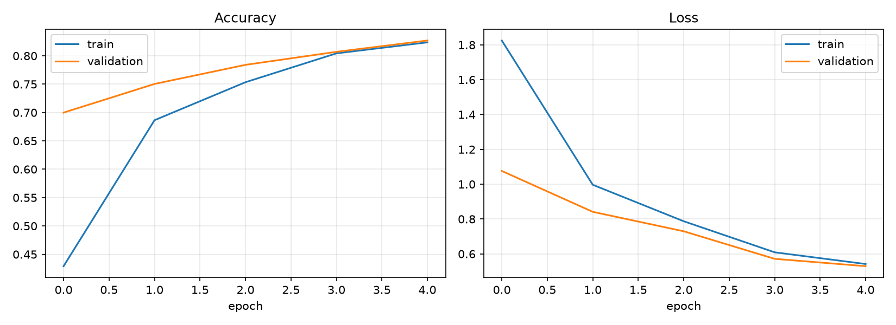
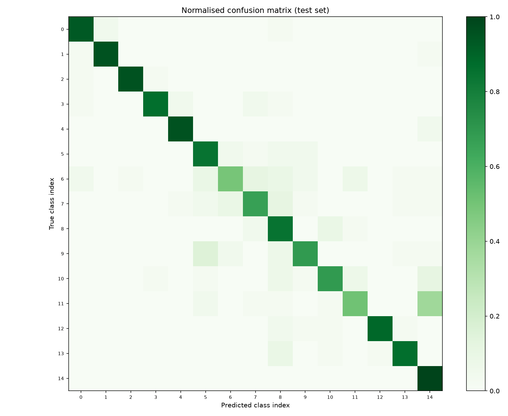

# Crop Disease Advisor

A deep-learning lab project: upload a photo of a leaf and the app tells you **which disease it is**, **where on the leaf the model looked** (Grad-CAM heatmap) and **what to do next** (treatment and prevention advice).

No video or webcam is involved. The input is a single image.


## Quick start

```bash
git clone https://github.com/mandar-birewar/crop-disease-advisor.git
cd crop-disease-advisor
python -m venv venv
venv\Scripts\activate             # Mac/Linux: source venv/bin/activate
pip install -r requirements.txt
python app.py                     # uses the trained model in model/
```

To retrain the model yourself, see "Get the dataset" and "Train" below.

## Real-world use case

Small farmers often cannot reach an agriculture expert quickly, and plant diseases such as potato late blight can wipe out a field within days. A phone photo plus this tool gives an instant first screening and tells the farmer when to call an expert.

## How it works

1. **Dataset**: PlantVillage, about 54,000 leaf images in 38 classes (14 crops, healthy and diseased).
2. **Model**: MobileNetV2 pretrained on ImageNet (transfer learning). Stage 1 trains only the new classifier head. Stage 2 fine-tunes the top 30 layers with a small learning rate.
3. **Explainability**: Grad-CAM shows which regions of the leaf influenced the prediction.
4. **Advisor**: a rule-based table maps the predicted disease to symptoms, action and prevention.
5. **UI**: Gradio web app.

```
leaf photo -> MobileNetV2 -> disease + confidence -> advice table
                  |
                  +-> Grad-CAM heatmap
```

## Project structure

```
crop-disease-advisor/
├── train.py          # training, evaluation, saves model + plots
├── gradcam.py        # Grad-CAM heatmap
├── advisor.py        # disease -> treatment advice
├── app.py            # Gradio UI
├── requirements.txt
├── LICENSE
├── .gitignore
├── model/            # created by train.py
├── results/          # created by train.py (curves, confusion matrix, report)
└── examples/         # optional: put 3-4 sample leaf photos here for the UI
```

## Setup

Python 3.10 to 3.12 is recommended (TensorFlow does not support newer versions yet).

```bash
python -m venv venv
source venv/bin/activate          # Windows: venv\Scripts\activate
pip install -r requirements.txt
```

## Get the dataset

Download "PlantVillage Dataset" by abdallahalidev from Kaggle and unzip it. Use the **`color`** folder, which contains one sub-folder per class (for example `Tomato___Late_blight`).

```bash
pip install kaggle
kaggle datasets download -d abdallahalidev/plantvillage-dataset
unzip plantvillage-dataset.zip -d data
# the folder to use is data/plantvillage dataset/color
```

Some Kaggle uploads of PlantVillage contain only 15 classes (Pepper, Potato, Tomato) in a folder such as `data/PlantVillage`. That works too: point `--data` at the folder that directly contains the class folders. Empty wrapper folders (for example a nested `PlantVillage/` copy) are skipped automatically.

## Train

Training on a laptop CPU with all images is slow. Two good options:

- **Google Colab (free GPU)**: upload the project folder, set the runtime to GPU and run the same commands. This takes roughly 10 to 20 minutes.
- **Laptop, fast mode**: cap the images per class.

```bash
# full dataset (use a GPU)
python train.py --data "data/plantvillage dataset/color"

# quick run on a laptop
python train.py --data "data/plantvillage dataset/color" --max-per-class 300 --epochs 3 --finetune-epochs 2
```

This creates `model/crop_disease_model.keras`, `model/class_names.json` and, in `results/`, the training curves, confusion matrix and per-class classification report. Use these in your report and slides.

## Results

Generated by `train.py` and saved in `results/`:

| Training curves | Confusion matrix |
|---|---|
|  |  |

The final test accuracy and the per-class precision, recall and F1 are in `results/classification_report.txt`.

## Run the app

```bash
python app.py
```

Open the local URL it prints (usually http://127.0.0.1:7860). Upload a leaf photo and click **Diagnose**.

## Demo tips

- Copy 3 or 4 test images (not used in training if possible) into `examples/` so you can click them during the presentation.
- Show one healthy leaf, one disease with a clear heatmap, and one low-confidence case to explain the warning.

## Viva questions you should be ready for

- **Why transfer learning?** A small dataset and limited compute. ImageNet features such as edges and textures transfer well to leaves.
- **Why MobileNetV2?** It is light enough to run on a phone or a low-cost server, which suits farmers.
- **What is fine-tuning and why a small learning rate?** We unfreeze the top layers so they adapt to leaves. A small rate avoids destroying the pretrained weights.
- **Why keep BatchNorm frozen?** Small batches give noisy statistics that can hurt a pretrained model.
- **What does Grad-CAM do?** It weights the last convolutional feature maps by the gradient of the predicted class and shows where the model looked, which helps check that it focuses on the lesion and not the background.
- **Which metrics did you use?** Accuracy, precision, recall, F1 and a confusion matrix, because accuracy alone hides weak classes.

## Limitations (be honest about these in the presentation)

- PlantVillage photos are taken in controlled conditions (single leaf, plain background). Accuracy on real field photos with messy backgrounds will be lower.
- Several images can come from the same leaf, so a random split can give optimistic test accuracy.
- The advice table is general guidance. It is not a prescription, and the app tells users to confirm with a local expert.

## Possible extensions

- Train on field images (for example PlantDoc) to improve real-world accuracy.
- Add Hindi or Marathi advice text.
- Export to TensorFlow Lite for an offline mobile app.
